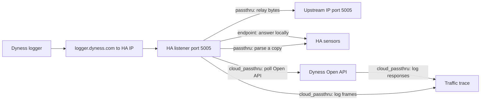
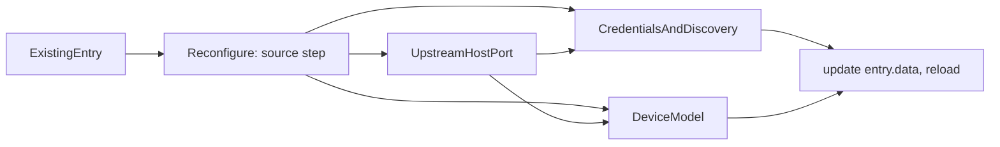

# Local logger listener

**Status:** product specification for this fork. Implementation follows this document. Wire format, opcodes, and field IDs stay in [`reverse-engineering/dyness_protocol_spec.md`](../reverse-engineering/dyness_protocol_spec.md) and [`reverse-engineering/dyness_all_fields.md`](../reverse-engineering/dyness_all_fields.md).

This tree is a local checkout of [shopf/dyness_battery](https://github.com/shopf/dyness_battery) at `v2.6.0` (`7e13bda`). The upstream integration polls the Dyness Open API (`open-api.dyness.com` or `apacopen-api.dyness.com`) every five minutes. The Wi-Fi logger speaks a different protocol: plaintext TCP to `logger.dyness.com` port **5005**, with an upload about every 300 seconds. Field `850000` reports that interval.

The Open API realtime endpoint returns `pointId` and `pointValue` pairs whose IDs are the same numeric field IDs the logger sends in `91 04` uploads. Upstream already maps those IDs to sensors. This fork reuses that mapping for local traffic instead of defining a second one.

Captures live in `reverse-engineering/captures/` and must not be committed. Login frames contain plaintext credentials and stay redacted.

## Rollout order

The captures already show the full session sequence (see the protocol notes, Session sequence). All three local sources can ship together.

`cloud_passthru` remains the way to collect new evidence: the still-open questions in the protocol notes (whether the greeting is required, the inner `0C 01` command, the clock offset) are answered from its traces.

## Sources

Each config entry has one source:

| Source | What it does |
|---|---|
| `cloud` | Existing API ID, API secret, and region flow in [`custom_components/dyness_battery/config_flow.py`](../custom_components/dyness_battery/config_flow.py). |
| `endpoint` | Home Assistant answers the logger as `logger.dyness.com`. |
| `passthru` | Home Assistant relays the logger session to a configured upstream address or hostname and parses a copy. |
| `cloud_passthru` | Passthru and cloud polling together, with a full traffic trace of both. |

A missing `source` key means `cloud`, so existing entries keep working. `endpoint` and `passthru` entries do not call the Open API and do not store `api_id` or `api_secret`. `cloud_passthru` stores both the upstream address and the cloud credentials.

`endpoint`, `passthru`, and `cloud_passthru` each bind TCP 5005. The config flow allows one of those entries. A further entry that would bind 5005 aborts. A `cloud` entry does not bind the port and may be installed beside `endpoint` or `passthru`.

## Network

DNS is configured by the operator, outside the integration. For `endpoint`, `passthru`, and `cloud_passthru`, `logger.dyness.com` resolves to the Home Assistant address (router, AdGuard, or another resolver the logger uses). The integration does not change DNS and does not write a hosts file on the logger.

The listener binds `0.0.0.0:5005` on the Home Assistant host and accepts the logger’s IPv4 TCP connection. The host firewall must allow inbound TCP 5005 from the logger. If the bind fails, the config entry is unavailable and the log records the bind error.

Home Assistant OS and Supervised installs run Core on the host network, so the port is reachable without extra steps. Home Assistant Container installs need `network_mode: host` or a published port (`-p 5005:5005`). The README states this.

`upstream_host` is an IPv4 address or a hostname. An IPv4 address is the normal choice. A hostname only works when Home Assistant's own DNS lookup returns the real cloud server. With per-client DNS (for example an AdGuard Home rewrite that applies only to the logger's address), Home Assistant can even use `logger.dyness.com`. A hostname is resolved on every upstream connect, so a changed cloud address is picked up. If it resolves to a loopback address or to one of Home Assistant's own addresses, the connect is refused as a loop and counts as a failed connect.

## Endpoint

Home Assistant is the server the logger already expects. It accepts the TCP session, answers the frames identified below, and publishes parsed telemetry. It opens no connection to Dyness.

### Handshake

From the captures, the logger connects and speaks first. Endpoint mode reproduces the server side of that sequence:

| Step | Logger sends | Endpoint replies |
|---|---|---|
| 1 | `91 00` login | `00 7F` greeting, then `91 00` with body `01` |
| 2 | `91 22` time request, empty body | `91 22` with the current UTC time as an 8-byte big-endian epoch millisecond count |
| 3 | `91 71` logger config | `99 71` with body `01` |
| 4 | `91 04` bank summary, then one `91 04` per board | `99 04` with body `01` for each frame |

The greeting has serial length `0`, opcode `00 7F`, and ASCII text in the same form as the cloud’s: `This is dyness.raymon service. node id is '<uuid>'`, with a UUID generated per connection. Whether the logger requires the greeting is untested, so endpoint sends it.

Every reply uses the length-prefixed frame and serial header from the protocol notes, with the serial from the request. Ack bodies are the single byte `01`; the cloud does not echo the measurement code.

The logger is stop-and-wait: it sends the next frame only after a reply. Endpoint therefore answers every frame in steps 3 and 4, in order, without delay. The logger repeats step 2 about every 12 hours inside a long session, and endpoint answers it the same way.

### What endpoint does not send

Endpoint sends no `00 77`. In the captures the cloud sends `00 77` command `0x1303` in reply to one board frame, which makes the logger resend that frame, and the logger answers the command only with a timeout result (`91 87 … 01 FF`). The clock-set command `0x12F8` repeats the time-sync value, which endpoint already supplies in step 2. Without `00 77`, endpoint should receive each board once per cycle.

### Parse failures

Acks are sent by opcode. A `91 71` or `91 04` frame whose typed fields fail to parse is still acknowledged, so the stop-and-wait logger does not stall or resend it. The parse failure is recorded. A frame whose length prefix or serial header is invalid is not answered, and the session is closed.

An unexpected `91 xx` opcode from the logger is recorded and not answered. If the logger then stalls, the session times out after twice the upload interval and is closed.

## Passthru

The listener accepts the logger, then opens a second TCP connection to `upstream_host` on `upstream_port` (default **5005**). Bytes are copied in both directions with no rewriting, including login frames. The parser used for endpoint mode reads both directions and publishes sensors from logger uploads.

Parsing and forwarding are independent. A frame that the parser does not understand is still forwarded.

There is no default upstream address. Addresses seen in captures (`47.254.174.207`, `8.211.25.186`) are examples for the operator, not built-in targets.

If the upstream connection fails, or closes, the listener closes the logger socket as well. It does not answer that session locally. The logger retries on its own.

Two upstream addresses have already been observed, so the configured address can go stale. After five consecutive failed upstream connects, the entry raises a Home Assistant repair issue naming `upstream_host`. The fix is the entry's Reconfigure action, changing `upstream_host` (see Changing an existing entry). The issue clears on the next successful connect.

`fallback_to_endpoint` is an optional entry option, off by default. When it is on and the upstream connect fails, the listener answers that session using the endpoint replies above, so Home Assistant keeps receiving data. Those uploads never reach the cloud.

In passthru, the cloud’s `00 77` still reaches the logger, so the duplicate board frame described in the protocol notes still occurs. The duplicate rule under Parsing and devices handles it.

Config keys for a passthru entry:

| Key | Required | Value |
|---|---|---|
| `source` | yes | `passthru` |
| `upstream_host` | yes | IPv4 address or hostname |
| `upstream_port` | no | integer, default `5005` |
| `device_model` | yes | model key, see Sensors |
| `device_sn` | no | bank measurement name, learned from the first upload (see Device identity) |
| `dongle_sn` | no | logger serial from the frame header, learned from the first upload |
| `fallback_to_endpoint` | no | boolean option, default off |

`endpoint` entries use the same keys without `upstream_host` and `upstream_port`.

## Cloud and passthru

`cloud_passthru` runs the passthru listener and the existing Open API poll on one config entry. The listener behaves as in passthru: it relays bytes unchanged to `upstream_host`:`upstream_port`, parses a copy, and closes the logger socket when the upstream connection fails. The coordinator polls on the existing five-minute interval and keeps the cloud write platforms (number, select, switch, time, and the base-setting and work-schedule services).

The purpose of this source is a complete trace. It logs every frame on the local TCP session and every Open API call the entry makes, including commands and responses the parser does not recognise.

Config keys:

| Key | Required | Value |
|---|---|---|
| `source` | yes | `cloud_passthru` |
| `upstream_host` | yes | IPv4 address or hostname |
| `upstream_port` | no | integer, default `5005` |
| `api_id` | yes | Open API ID |
| `api_secret` | yes | Open API secret |
| `api_base` | yes | regional API base chosen during discovery |
| `device_sn` | yes | device selected by the existing discovery step |
| `dongle_sn` | no | collector serial when discovery provides one |

The config flow collects `upstream_host` and `upstream_port`, then continues through the existing API credential, region, and device-selection steps. The same steps are available from the Reconfigure action, so an existing `cloud` entry can become `cloud_passthru` in place. The model comes from cloud discovery (`deviceModelName`), as it does for `cloud` entries. The same rejection rules apply: a missing `upstream_host`, or one that is neither an IPv4 address nor a valid hostname, is rejected.

### Merge rule

The cloud values for a point ID come from the same logger upload that Home Assistant already parsed, rounded and delayed. When both sources supply a sensor key:

- The local value is used while the logger session is fresh, meaning a `91 04` frame arrived within twice the last reported `850000` interval (600 seconds until that field is seen).
- When the local data is stale, the cloud value is used.
- Board keys are merged per board. A board that the logger sent in the current cycle uses its local values even when the cloud omits it from `SUB`. A board missing locally uses the cloud board values only if that board's `TIME` entry is newer than its last local sample.
- Cloud freshness is judged by the cloud's own data time (bank point `T`, and the per-board `TIME` list in `SUB` order), not by when the poll returned. A cloud response whose `T` has not advanced since the previous poll adds nothing new.
- Keys only the cloud supplies (station capacity, daily and lifetime energy, PV, grid, load, firmware from device detail) always come from the cloud.

The merge works on point IDs, before upstream’s mapping. Each `compare` record has a `used` field: per point ID `local` or `cloud` for the bank, or one value per board or power response.

## Cloud API and config flow

The current user step asks for `api_id`, `api_secret`, and `region`, then discovers a device. The first config-flow step becomes a source choice: Cloud API, Local endpoint, Local passthru, Cloud and passthru. Cloud continues through the existing discovery and device-selection steps unchanged. Cloud and passthru adds the upstream address step, then uses those same discovery steps.

`endpoint` and `passthru` add a model step. It is a select over the keys of `_MODEL_SCHEMA_MAP` in [`custom_components/dyness_battery/__init__.py`](../custom_components/dyness_battery/__init__.py), stored as `device_model`. Schema detection then runs on that value exactly as it runs on `deviceModelName` for cloud entries. A model is required because the logger does not send one, and the point fallback in `_detect_schema` returns `SCHEMA_JUNIOR` whenever point `800` is present. The bank summary frames in the captures include `800`.

`async_setup_entry` branches on `source` (entries without the key are `cloud`). `cloud` runs upstream’s setup unchanged. The other sources go through `local/ha.py`: `cloud_passthru` constructs `DynessDataCoordinator` with the API credentials; `endpoint` and `passthru` construct it with placeholder credentials and the stored `device_sn`, or, before the battery serial is known, the entry ID as a temporary identifier (see Device identity below). All three bind `_call` to the local responder (see Local responder) and start the TCP listener. `endpoint` and `passthru` do not call `async_config_entry_first_refresh`; entities appear unavailable until the first upload cycle completes.

Cloud write platforms stay registered for `cloud` and `cloud_passthru`. `endpoint` and `passthru` forward only the sensor platform and do not register the write services.

Only one entry with a listener source (`endpoint`, `passthru`, `cloud_passthru`) can exist, because they all bind port 5005; the config flow rejects a second one. If the port is already taken at startup, setup raises `ConfigEntryNotReady` and Home Assistant retries.

### Device identity

The logger sends the serials the cloud uses. The bank measurement name (for example `R07E944668050216-BMS`) is the cloud's `deviceSn`, and the frame-header serial (`R07E944668050216`) is the cloud's `collectorSn`. Every source therefore uses `deviceSn` as the pack device identifier and `{deviceSn}_{board serial}` for module devices, as upstream does. Device names come from `stationName` or "Dyness Battery", and entity names from translation keys, so neither changes with the source.

- **Cloud entry switched to a local source.** `entry.data` already holds `device_sn`, so the pack and module devices stay as they are.
- **New local entry.** Before the first upload the serial is unknown. Platforms must be loaded during setup, so the pack device is first created with the entry ID as a temporary identifier. When the first upload cycle with a bank frame completes, before the coordinator refresh that adds module entities, the entry stores `device_sn` (bank measurement name) and `dongle_sn` (logger serial) in `entry.data`, and renames the pack and every module device identifier in place with the device registry's `async_update_device(new_identifiers=...)`. No device is orphaned, and from then on the identifiers match what cloud discovery returns.
- **Local entry switched to `cloud` or `cloud_passthru`.** Discovery returns the same `deviceSn`, so nothing changes. If discovery returns a different serial (a different battery on that account), the reconfigure asks for confirmation before replacing it.
- **Serial mismatch.** If a local entry with a stored `device_sn` receives uploads with a different bank name (logger swapped, or moved to another battery), the entry keeps its stored serial, logs a warning and raises a repair issue. Devices are not renamed silently.
- **Unique ID.** `cloud` and `cloud_passthru` entries use `{api_id}_{device_sn}`, as upstream does. Local entries set `local_{device_sn}` once the serial is known, so the same battery cannot be added twice.

### Changing an existing entry

An existing entry is changed with Home Assistant's **Reconfigure** action (`async_step_reconfigure` and `async_update_reload_and_abort`, Home Assistant 2024.11 or later), not by adding a second entry. It updates `entry.data` and reloads the entry. Entity unique IDs are `{entry_id}_{key}` and `{entry_id}_{module}_{key}`, and the entry ID does not change, so every entity ID and its history carry over.

Reconfigure reuses the add-entry steps, starting at the source choice, with the current values filled in:

- `cloud`: credentials, region, then device discovery. When credentials and `device_sn` are already stored, the step offers to keep them without asking again.
- `endpoint`: device model.
- `passthru`: upstream host, upstream port, device model.
- `cloud_passthru`: upstream host and port, then credentials and discovery.

Keeping the current source and changing only the upstream host, port or model follows the same path. This is how the "upstream unreachable" repair is fixed in place.

What is kept in `entry.data`:

- API credentials, `api_base`, `device_sn`, `dongle_sn` and `known_module_sns` are kept when switching to `endpoint` or `passthru`. Local sources do not use the credentials, but switching back to `cloud` then needs no new entry.
- `upstream_host`, `upstream_port` and `device_model` are kept when switching to `cloud`, and are shown again when their source is chosen later.
- Options (`battery_capacity_override`, `alarm_delay_minutes`, `fallback_to_endpoint`, `capture_unknown_raw`) are not touched.

Rules:

- The single port-5005 rule ignores the entry being reconfigured.
- `upstream_host` validation and the `device_model` requirement are the same as for a new entry.
- After reconfiguring to `cloud` or `cloud_passthru`, the unique ID becomes `{api_id}_{device_sn}`. If another entry already uses it, the reconfigure is aborted.

Entities after a switch:

- Switching to `endpoint` or `passthru` stops loading the number, select, switch, time and button platforms. Their entities stay in the registry and Home Assistant shows them as no longer provided.
- Cloud-only sensors (daily and lifetime energy, PV, grid, load) become unavailable.
- Nothing is deleted automatically, so switching back restores them. The README explains how to remove them by hand.

`hacs.json` sets the minimum Home Assistant version to 2024.11.0, the first release with reconfigure flows in this form.

## Parsing and devices

The listener follows the framing and typed-field rules in the protocol notes. Login payloads are omitted from every export, log line, and stored state.

One listener serves one battery bank. A second logger connecting to the same entry would overwrite the same store; supporting several loggers per entry is not implemented.

Bank summary frames (measurement name ending in `-BMS`) update the pack device. Other `91 04` frames are board frames. `91 71` updates logger diagnostics (logger firmware `601000`, hardware revision `602000`, selected server `613200`, upload interval `850000`) and does not overwrite pack measurements.

### Boards and duplicates

The captures contain four BMS boards in three physical batteries. Bank field `400` is 4 and counts boards, not batteries. One 200 Ah battery holds two boards, probably `…0001` and `…0002` (same generation, about 530 cycles each). Each of those two boards reports 198 Ah in `14000`/`14100`, although each module is really about 100 Ah; the values are wrong on that battery and are published as reported. The other two batteries have one board each and report 200 Ah. In 433 of 445 cycles, board `…0003` is sent twice with identical bytes, because the cloud’s `00 77` makes the logger resend it. Endpoint mode does not send `00 77`; passthru and `cloud_passthru` still see the resend. Rules:

- A board is keyed by field `10000`. When that field is absent, the measurement name in the `91 04` header is the key.
- Within one upload cycle, the latest frame for a board key is that board’s sample. Earlier frames with the same key in that cycle are recorded in the trace and otherwise dropped.
- An upload cycle starts at a bank summary frame and ends at the next one.
- Bank field `400` and logger field `851000` give the expected board count. When a cycle ends with fewer distinct boards than that count, the trace records the shortfall. Missing boards keep their previous values until the offline timeout.
- Bank capacity is never the sum of board `14100` values, and is never a per-board capacity multiplied by `400`; on this system either would give 800 Ah instead of 600 Ah. Pack kWh figures use `battery_capacity_override` (or station info for cloud entries), as listed under Local-only keys.
- The cloud's `SUB` list is not a reliable board count. Over seven polls on 2026-10-12 it listed all four boards three times and dropped one or two of them in the other four, while `400` stayed 4. One five-minute upload was also missing from the cloud. The cause is not needed. A board absent from `SUB` is not offline and its entities are not removed. Upstream already keeps the union of every `SUB` it has seen (`known_module_sns`) and polls each known board; the fork keeps that behaviour for `cloud` and `cloud_passthru`.
- Cells are read for `10200` (cell count) entries starting at `10300`, in steps of 100. Slots past that count are ignored even when present with value `0.0`, as `11900` and `12000` are in the captures.

## Sensors

Local frames are converted to the same dicts the cloud coordinator builds. Upstream’s schema code then produces the sensor keys. The spec does not keep its own field-to-sensor table.

### Point dicts

- The bank summary frame becomes `realtime_data`: `{str(field_id): value}` for every typed field in the frame.
- Each board frame becomes one point dict, passed to `_parse_module_points(sn, mid, pts)`. Its output goes into `module_data`. Board frames from the captures carry `10000` and `10300`, so they take the existing `is_dl5` branch: `13500` voltage, `13400` current, `13900` cycle count, `12400` BMS temperature, `12500`/`12600` cell temperatures, `10300`…`11800` cells, and `14000`/`14100` as amp-hours when above 100.
- Values reach upstream as strings in the cloud’s format, because some upstream checks compare strings (for example `str(rt.get("3208")) == "1"`). Integers are written plain (`"95"`), floats at float32 precision (`"53.04"`, `"200.0"`), text as is.

The field dictionary lists IDs such as `3201`…`3208` as synthetic: bit 0 through bit 7 of `3200`. The cloud returns those IDs as separate points. When a frame carries a bitmask field (`3200`, `3300`, `3400`, `3500`, `4000`, `17700`, `17800`, `19700`) but not its bit points, the converter adds `<id + n>` for bit `n - 1`, with value `0` or `1`. The bit order is confirmed against the cloud (`3200` = 128 with only `3208` = 1); the `cloud_passthru` comparison records keep checking it. Field and bit labels, in the trace and wherever the code needs a name, come from [`reverse-engineering/cloud_point_names.json`](../reverse-engineering/cloud_point_names.json). Local-only fields with no cloud name keep the label from `dyness_all_fields.md`.

### Local responder

Upstream’s point-to-sensor code is inline in `DynessDataCoordinator._async_update_data`, mixed with HTTP calls. The fork does not move it. Every Open API request in that method goes through `self._call(session, path, body)`, so local entries replace `_call` on the coordinator instance with `local/responder.py`, which answers each path with cloud-shaped JSON built from the latest logger frames. Upstream’s schema detection, mapping, capacity maths, alarm decoding, and module handling then run unchanged, and local and cloud entries produce the same sensor keys.

| Path | Local answer |
|---|---|
| `/v1/device/storage/list`, `/v1/device/household/storage/detail` | one device: `deviceSn` = bank measurement name, `collectorSn` = logger serial, `deviceModelName` = `device_model`, `firmwareVersion` = bank `300`, `deviceCommunicationStatus` `Online` / `Offline` from freshness |
| `/v1/device/bindSn` | success |
| `/v1/station/info` | `batteryCapacity` = `battery_capacity_override` divided by the number of known boards (upstream multiplies it back), or empty without the option |
| `/v1/device/realTime/data` | bank: `T`, `SUB` (boards seen locally), `TIME`, then every bank field; board serial: `T` then that board’s fields. Values are strings in the cloud’s format (integers plain, floats at float32 precision) |
| `/v1/device/getLastPowerDataBySn` | `soc` = `800`, `realTimeCurrent` = `700`, `realTimePower` = `600` × `700`, `createTime` |
| `/v1/device/getLastRunningDataBySn` | empty success, so upstream marks running data all-null and stops asking |
| `/v2/Set*` | code `403`; local-only entries do not load the write platforms or services |
| anything else (for example `/v2/GetRealTimeDataBySN`) | code `404`, which upstream already tolerates |

Upstream’s single sub-module poll asks `realTime/data` for that board serial and gets the board’s points, so no separate cell copy is needed.

For `endpoint` and `passthru` the coordinator has no update interval and upstream’s `_update_scan_interval` is disabled. A refresh runs when an upload cycle completes (all expected boards seen, or 30 seconds of quiet after the last board frame). `cloud_passthru` keeps the cloud coordinator’s own interval; the responder wraps the real `_call` and applies the merge rule to `realTime/data` and `getLastPowerDataBySn`.

### Local-only keys

Supplied by the responder:

| Sensor key | Source |
|---|---|
| `createTime` | the cycle timestamp from the frame metadata (8-byte epoch ms). If it differs from the receive time by more than 5 minutes, the receive time is used and the trace records the offset. The cloud has set the logger clock to UTC+2 in in-session resyncs, so passthru and `cloud_passthru` will usually take the receive time. Endpoint sends true UTC on every time sync, so its logger clock stays correct. |
| `deviceCommunicationStatus` | `Online` while frames arrive, `Offline` after the timeout below |
| `firmwareVersion` | bank field `300` (host firmware). Logger firmware `601000`, hardware `602000`, selected server `613200` and the interval are kept by the store and written to the trace; there is no logger device or entity yet. |
| `batteryCapacity` | the existing `battery_capacity_override` option. Without it, `usableKwh` and `remainingKwh` are unavailable. |

### Unavailable locally

These keys have no source in the logger upload and stay unavailable on `endpoint` and `passthru`: daily and lifetime energy counters, PV, grid, load, and inverter sensors. Field `14000`/`14100` amp-hours are not converted to kWh unless `batteryCapacity` is set, matching upstream.

### Timeout

The upload cadence remains the logger’s own interval from field `850000` (observed value 300 seconds). `endpoint` and `passthru` do not poll. The local data is stale when no `91 04` frame has arrived for twice the last reported `850000` value. Until that field has been seen, the timeout is 600 seconds. For `endpoint` and `passthru`, a check every 60 seconds then fails the coordinator refresh, so all entities become unavailable instead of holding old values; they recover on the next upload cycle. The responder still reports `Offline` for `deviceCommunicationStatus` to any refresh that runs while stale. `cloud_passthru` uses that same timeout for the local side, switches to cloud values when it passes, and keeps the Open API poll. The same timeout closes an idle logger session.

## Logging

For `cloud`, `endpoint`, and `passthru`, logs include the opcode, the logger serial, and parsed measurement values. Login bodies are omitted. Raw frame bytes are omitted. Config entries, the recorder, and debug traces do not retain credentials.

### Cloud and passthru trace

`cloud_passthru` appends one JSON object per event to `dyness_cloud_passthru.log` in the Home Assistant configuration directory. The Home Assistant log records the file path when the entry starts, then stays at the summary level used by the other sources.

`api_secret` and the `Authorization` header are omitted from every line. A login frame (`91 00` toward the upstream) is recorded as opcode, direction, serial, and byte length, with the body replaced by `"redacted"`.

Every record has `source` (`local` or `cloud`), UTC time, and `status`:

| `status` | Meaning | Frames | Recorded payload |
|---|---|---|---|
| `parsed` | layout and meaning documented | `91 00`, `00 7F`, `91 22`, `91 71`, `91 04`, `99 71`, `99 04`, `00 77` clock set (`0x12F8`, inner `08 02`) and its `91 87` | parsed fields, status byte, decoded clock value |
| `opaque` | layout known, meaning unresolved | `00 77` with any other command ID or inner command (including `0x1303`, inner `0C 01`), and its `91 87` | full body hex plus the decoded tunnel fields |
| `unknown` | opcode not recognised, body failed to parse, or bytes that do not form a valid frame | anything else | full frame hex, length prefix included |

For every `00 77`, the trace decodes the tunnel layout from the protocol notes: command ID, inner command, inner data, and whether the CRC-16/XMODEM matches. A CRC mismatch makes the record `unknown`. For every `91 87`, it records the echoed command ID, the result byte, and the delay since the matching `00 77`.

`grep '"status": "opaque"'` finds the recognised-but-unexplained frames, such as the recurring `0x1303` command. `grep '"status": "unknown"'` finds new commands and responses. Both are inputs to the protocol notes.

**Local traffic.** Every reassembled frame on the port 5005 session is written, in both directions (`logger_to_upstream` and `upstream_to_logger`). Each record has direction, peer addresses, opcode, and logger serial when the header parses. Parsed `91 04` and `91 71` records include the measurement name and every typed field: id, type, and value. Duplicate board frames and board-count shortfalls (see Boards and duplicates) are recorded. Each `91 22` reply and each clock-set `00 77` records the time it carries and its offset from the receive time.

**Cloud traffic.** Every Open API call made for this entry is written: the request path, the JSON request body, the HTTP status, and the response body. That covers discovery (`/v1/device/storage/list`, `/v1/device/bindSn`), station and device detail, realtime and power polls (`/v1/device/realTime/data`, `/v1/device/getLastPowerDataBySn`, `/v1/device/getLastRunningDataBySn`), submodule polls, and write calls. A non-JSON response is stored as text.

All Open API requests go through `DynessDataCoordinator._call` in `__init__.py` or `_fetch_device_list` in `config_flow.py`. The trace hooks both.

**Comparison records.** After each cloud `/v1/device/realTime/data` response, the trace writes one `compare` record. For every point ID present in the response, it lists the cloud value, the latest local value for that ID, and the time of each. Point IDs present in the response but never seen on the wire are listed separately; the server derives those. Each record also stores the cloud `T` and the `SUB` list with its `TIME` entries, which the merge rule uses. The comparison records are how the field dictionary moves IDs from tentative to confirmed, including the bit order of the synthetic bit IDs.

**Which source won.** For each published sensor key, the trace records whether the local or cloud value was used under the merge rule.

### Trace file handling

- The file rotates at 10 MB and keeps 5 backups.
- Records go through a queue drained in the executor. The event loop does no file I/O.
- The trace contains the logger MAC (`609000`), its LAN address (`896000`), serial numbers, and full telemetry. The README and the trace header line state that it is sensitive and must not be shared unredacted.
- `capture_unknown_raw` is an entry option, on by default. When it is off, `unknown` records keep opcode, direction, and length, and the hex is omitted. An unknown frame could contain credentials in a layout nobody has seen yet.

## Code layout and tests

`__init__.py` is about 160 KB. New code lives in `custom_components/dyness_battery/local/`:

| Module | Contents |
|---|---|
| `const.py` | config keys and source names |
| `protocol.py` | frame splitting, serial header, typed-field parser, metadata timestamp, bitmask expansion, `00 77` / `91 87` decode, endpoint reply builders |
| `store.py` | latest bank and board samples, upload cycles, duplicate rule, freshness, `createTime`, logger diagnostics |
| `listener.py` | asyncio TCP server, endpoint replies, passthru relay with hostname resolution and loop guard, `fallback_to_endpoint` |
| `responder.py` | cloud-shaped answers for `_call`, `cloud_passthru` merge rule and `compare` records |
| `trace.py` | JSON trace writer, rotation through a queue thread, redaction |
| `ha.py` | Home Assistant glue: coordinator construction, responder binding, serial learning and device rename, repair issues, stale check, unload |
| `point_names.json` | copy of `reverse-engineering/cloud_point_names.json`, read at runtime for trace labels |

Only `ha.py` imports Home Assistant. Upstream files change only where needed: `async_setup_entry` / `async_unload_entry` in `__init__.py`, the config and options flow, strings and translations, and the manifest.

[`reverse-engineering/dyness_decode.py`](../reverse-engineering/dyness_decode.py) and `protocol.py` must decode a frame the same way. `tests/test_decoder_parity.py` runs both on the same fixtures, and on every upload in the private captures when they are present.

Tests (upstream has none):

- `tests/test_*.py` need only pytest and Python 3.9+. Fixtures are hand-built, sanitized frames (`tests/frames.py`) with a made-up serial. No capture bytes and no login bodies.
- They cover framing, typed fields, bitmask expansion, `00 77` CRC and clock decode, endpoint reply bytes, upload cycles and duplicates, freshness, `createTime`, the responder’s JSON, and the merge rule.
- `tests/ha/` runs with `pytest-homeassistant-custom-component` installed (Python 3.13+). It covers the config flow paths and sets up `endpoint` and `cloud_passthru` entries end to end over a real TCP socket, checking sensor states, the repair issue, the trace file, and unload. `test_reconfigure.py` covers source switches, kept credentials, the guards, serial learning and the mismatch repair.
- `tools/dyness_local_runner.py` runs the listener outside Home Assistant. `tools/dyness_replay.py` replays the logger side of a classic PCAP against it and checks the replies to every frame.

## Manifest and fork identity

[`custom_components/dyness_battery/manifest.json`](../custom_components/dyness_battery/manifest.json) is `iot_class: local_push`. A manifest can name only one class; the README states that cloud entries still poll every five minutes. `after_dependencies` lists `network`, which the loop guard uses to learn Home Assistant’s own addresses.

The fork keeps domain `dyness_battery`, so it is a drop-in replacement. Existing cloud entries and entity IDs carry over. It cannot be installed beside upstream; the README says to remove the upstream HACS repository first. `codeowners`, `documentation`, and `issue_tracker` point at the fork, and `version` carries a fork suffix (for example `2.6.0-local.1`) so HACS does not offer upstream releases as updates.

## Open questions

Answered from the captures and recorded in the protocol notes: handshake order, greeting body, ack bodies, the metadata timestamp, the `00 77` tunnel layout and clock-set command, and the cause of duplicate board frames. Answered from the cloud point names: the bit order of the status words and the meaning of each status bit.

Still open, tracked in the protocol notes:

- Whether the logger accepts a session without the `00 7F` greeting:
- What inner command `0C 01` (`00 77` ID `0x1303`) asks for, and whether any result other than `FF` occurs.
- Why the cloud answers time sync with UTC after login but UTC+2 in in-session resyncs. The `cloud_passthru` trace records each time-sync value and its offset from receive time.
## Out of scope

- HTTP firmware checks to `cloud.raymoniot.com:9002`.
- Rewriting telemetry or login frames.
- Sending inverter or BMS commands, including `00 77`.
- Changing the logger’s configured server list. The operator points DNS at Home Assistant; the logger keeps `logger.dyness.com` as its configured host.

## Acceptance

- With `logger.dyness.com` resolving to Home Assistant, a logger TCP session to port 5005 is accepted for `endpoint`, `passthru`, and `cloud_passthru`.
- Endpoint answers `91 00` with the `00 7F` greeting and `91 00 01`, answers `91 22`, `91 71`, and `91 04` as listed above, acknowledges by opcode even when typed fields fail to parse, and sends no `00 77`.
- Replaying the logger side of `captures/dyness.pcap` against endpoint produces one reply per logger frame, in the cloud’s order, with identical ack bodies.
- Passthru and `cloud_passthru` copy bytes to the configured upstream and close the logger socket when that upstream is down. Five consecutive failures raise a repair issue.
- A passthru or `cloud_passthru` entry without `upstream_host` is rejected by the config flow. A hostname that resolves to Home Assistant itself is refused at connect time and counts toward the repair issue. An `endpoint` or `passthru` entry without `device_model` is rejected.
- Board frames with a duplicated `10000` in one upload cycle produce one sample.
- Local and cloud responses produce the same sensor keys, because both run through upstream’s unchanged mapping.
- Login material is omitted from logs and stored state. In the `cloud_passthru` trace the login body is the marker `redacted`.
- An existing cloud config entry still polls the Open API.
- Reconfiguring a cloud entry to `cloud_passthru`, `endpoint` or `passthru` keeps every entity ID and the pack device.
- A new local entry's pack and module devices carry the same identifiers as a cloud entry for that battery from the first upload on, with no orphaned device.
- Switching back to `cloud` needs no credential entry when the credentials are stored.
- Reconfigure is refused when it would create a second port-5005 entry or a duplicate cloud unique ID.
- A `cloud_passthru` entry writes each Open API request and response, each local frame with its `status`, and one `compare` record per realtime poll to `dyness_cloud_passthru.log`.
- `00 77` command `0x1303` and its `91 87` appear with `status` `opaque`, full body hex, and decoded tunnel fields. Clock-set `0x12F8` appears as `parsed` with the decoded time. Unrecognised frames appear with `status` `unknown` and full frame hex unless `capture_unknown_raw` is off.
